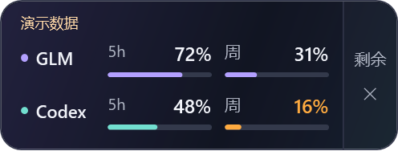
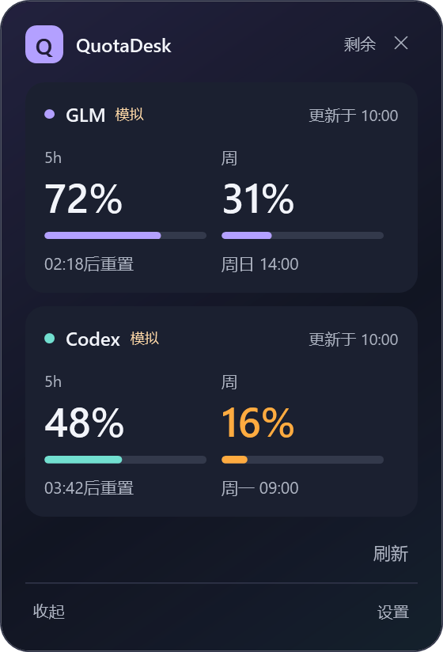
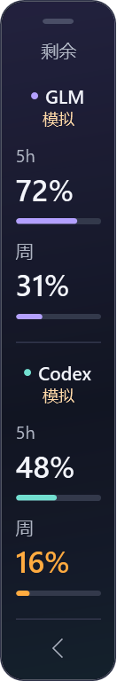
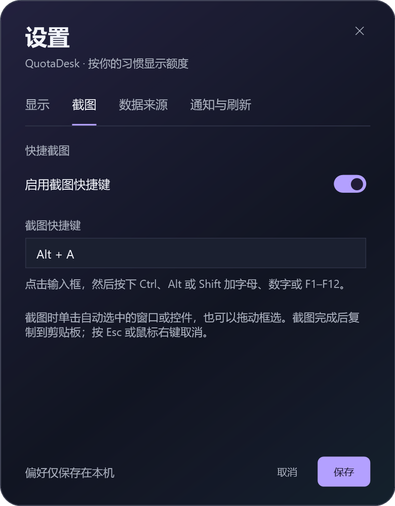

# QuotaDesk

QuotaDesk 是 Windows 桌面上的额度悬浮工具，显示 Codex 和智谱国内 GLM Coding Plan 的额度，并提供本地截图功能。

## 功能

- 悬浮窗与任务栏挂件显示 5 小时、每周额度；支持已用/剩余切换、刷新及错误/旧数据标记。
- 本地截图：默认 Alt+A，鼠标悬停时尝试识别窗口或控件；单击截图或拖动框选后复制到剪贴板。Esc 或鼠标右键取消。可在设置中关闭或修改快捷键。
- 截图仅在本机处理；控件识别效果取决于目标程序。受保护内容或某些远程桌面、硬件加速窗口可能无法正常捕获。

## 界面预览

以下界面使用模拟数据，显示的额度和重置时间均为示例。

| 紧凑模式 | 详细模式 | 微缩栏 |
| :---: | :---: | :---: |
|  |  |  |

任务栏挂件也可显示两个平台的额度，鼠标悬停查看详情。关闭悬浮窗后，程序继续在托盘运行；通过托盘菜单可重新打开窗口或退出。

## 截图设置

在系统托盘中右键 QuotaDesk 图标，打开 **设置 → 截图**，可开启或关闭截图功能，并设置快捷键。



默认使用 **Alt+A**。截图时，单击自动识别的窗口或控件，或按住鼠标左键拖动框选；完成后图片进入剪贴板。按 **Esc** 或鼠标右键可取消。

## 环境与构建

需要 Windows 10/11 x64、.NET 10 SDK。

```powershell
dotnet restore QuotaDesk.sln
dotnet test QuotaDesk.sln
dotnet run --project src/QuotaDesk/QuotaDesk.csproj
```

生成独立运行包：

```powershell
dotnet publish src/QuotaDesk/QuotaDesk.csproj -c Release -r win-x64 --self-contained true -p:PublishSingleFile=true -o dist/QuotaDesk
```

## 本地数据与服务

设置和日志保存在当前 Windows 用户的 `%APPDATA%\QuotaDesk\`。GLM API Key 由用户自行输入，使用当前用户范围的 Windows DPAPI 加密保存。Codex 额度读取本机 Codex CLI 登录文件；此应用不自动刷新或改写该文件。请不要将密钥、登录文件、设置或截图提交到仓库。

两项额度功能分别请求 ChatGPT 和智谱的用量接口；接口及响应格式可能变化。截图快捷键如果被其他程序占用，可在设置中更换。

测试夹具中的凭据和用量数字为虚构样例，不对应真实账户。

额度数据接入的设计参考了 [Pulse](https://github.com/qunqin24/Pulse)（Apache-2.0）的公开实现。
